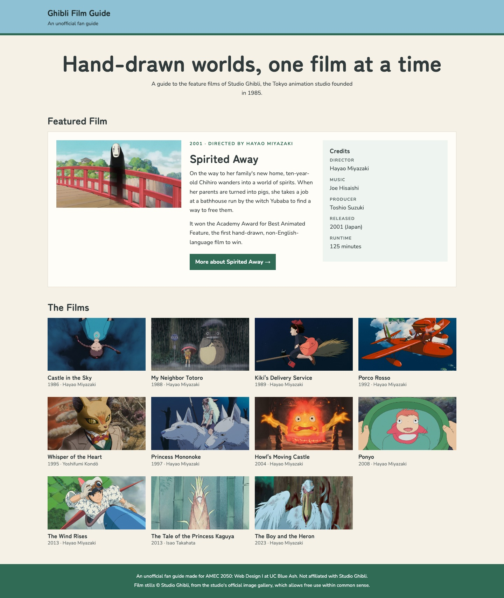
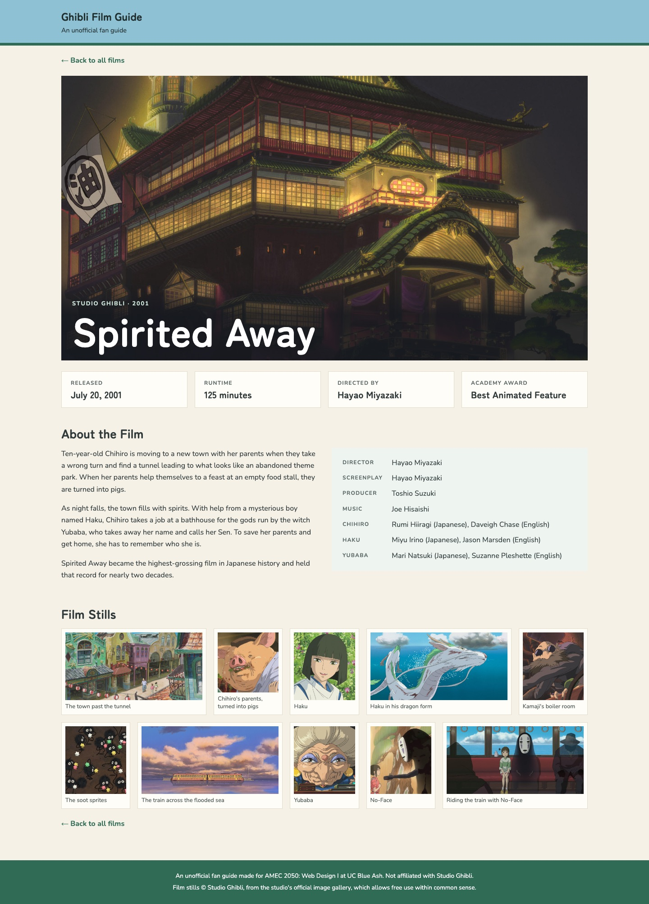
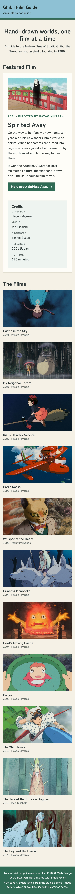
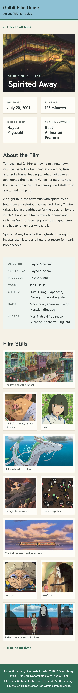

# 🎬 Ghibli Film Guide: CSS Grid Layout

## 🎯 Overview

The Ghibli Film Guide is a two-page fan site about the films of Studio Ghibli. The HTML, colors, fonts, and spacing are
already done, but every section stacks in a single column. Your job is to lay out both pages with CSS Grid so they
adapt to any screen size on their own, without a single media query.

Follow along with the companion video to complete the exercise.

## 📋 Requirements

- [ ] Create `css/grid.css` and link it on both pages, right after `css/base.css`. That `link` is the only change to
  `index.html` and `spirited-away.html`.
- [ ] All of your CSS is in `css/grid.css`. `css/base.css` is unchanged.
- [ ] No media queries. Every layout adapts to the screen size with Grid alone.
- [ ] The main headings on both pages scale smoothly with the width of the screen.
- [ ] **Homepage:** the featured film's image, description, and credits sit side by side when there's room, and stack
  when there isn't.
- [ ] **Homepage:** the film cards fill each row, and every card stays the same width, even on the last row.
- [ ] **Film page:** the film's title sits on top of the hero image, along its bottom edge.
- [ ] **Film page:** the four quick facts line up in a row when there's room.
- [ ] **Film page:** the synopsis and credits sit side by side when there's room. In the credits, each label sits to
  the left of its value, and the labels take only the space they need.
- [ ] **Film page:** the stills gallery has rows of equal height, and the wide stills span two columns.
- [ ] Both pages work at every width from a phone to a wide desktop, with no horizontal scrolling.

## 🖼️ Example Output

Your finished pages should look like this on a desktop:

| Homepage                                                                                                           | Film page                                                                                                           |
|--------------------------------------------------------------------------------------------------------------------|---------------------------------------------------------------------------------------------------------------------|
|  |  |

And like this on a phone:

| Homepage                                                                                                      | Film page                                                                                                      |
|---------------------------------------------------------------------------------------------------------------|----------------------------------------------------------------------------------------------------------------|
|  |  |

Resize your browser window slowly from wide to narrow. Columns should drop one at a time as the space runs out, with
no sudden jumps.

## 📂 Starter Files

| File / Folder        | Purpose                                                          |
|----------------------|------------------------------------------------------------------|
| `index.html`         | Homepage: intro, featured film, and the film wall                |
| `spirited-away.html` | Film page: hero, quick facts, about, and stills gallery          |
| `css/base.css`       | Colors, fonts, and spacing for both pages. Don't edit this file. |
| `css/grid.css`       | **Your layout goes here.** Create it and link it on both pages.  |
| `images/films/`      | One image for each film on the homepage                          |
| `images/stills/`     | Hero image and gallery stills for the film page                  |

## 🧮 Grading

<!-- Add point values and the due date. -->

| Criteria                                                          | Points |
|-------------------------------------------------------------------|--------|
| Homepage layout: featured film and film wall                      |        |
| Film page layout: hero, quick facts, about, and stills            |        |
| Responsive at every width with no media queries                   |        |
| Fluid headings                                                    |        |
| Code quality: `grid.css` linked on both pages, clean and readable |        |
| **Total**                                                         |        |

## 📚 Resources

- [CSS grid layout (MDN)](https://developer.mozilla.org/en-US/docs/Web/CSS/CSS_grid_layout)
- [`repeat()` (MDN)](https://developer.mozilla.org/en-US/docs/Web/CSS/repeat)
- [`minmax()` (MDN)](https://developer.mozilla.org/en-US/docs/Web/CSS/minmax)
- [`clamp()` (MDN)](https://developer.mozilla.org/en-US/docs/Web/CSS/clamp)
- [A Complete Guide to CSS Grid (CSS-Tricks)](https://css-tricks.com/snippets/css/complete-guide-grid/)

## 🆘 Getting Help

<!-- Office hours, discussion board, tutoring center, etc. -->

---

The AI policy and submission instructions are in the [README](../README.md).
